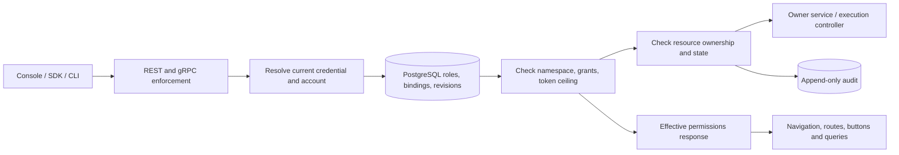

# Nexus RBAC and module access specification

Status: target implementation contract, September 13, 2026. Namespace-scoped human module RBAC is implemented. See [RBAC-IMPLEMENTATION.md](RBAC-IMPLEMENTATION.md) for shipped behavior, validation, compatibility, and remaining gaps. The full catalog below is not yet implemented.

## Scope

Build namespace-scoped roles, module/action permissions, user and service-account assignments, and consistent API/UI enforcement. PostgreSQL remains authoritative. Both EKS and AKS use the same application permission model; Azure/AWS IAM and Kubernetes RBAC remain separate enforcement boundaries.

A hidden module must also be inaccessible by direct URL, REST, exports, search, graph drill-down, and background data fetching. Hiding navigation is not authorization. Apply least privilege, deny by default, and validate each request, as recommended by the OWASP Authorization Cheat Sheet.

## Permission model

A permission is an exact registered identifier such as `runs.cancel`. Roles contain explicit permission identifiers, not wildcard strings. A new feature therefore does not silently become available to every custom role.

User effective grants = union of active role bindings within the requested namespace.

Service-account effective grants = union of its active role bindings, intersected with the presented token's explicit permission ceiling.

An operation is allowed only if the account and credential are active, the binding is valid, the resource belongs to the requested namespace, every required permission is granted, and resource-state rules permit the operation. The request namespace never substitutes for the resource's actual stored namespace.

No role inheritance, user-specific allow/deny overrides, or arbitrary policy scripts in the initial implementation. Multiple roles combine by union. No roles means no business-module access. Personal settings, identity inspection, and logout remain accessible to authenticated accounts. Explicit denies can be introduced later only with a defined conflict policy.

## Built-in roles

| Role | Intended use | Authority |
|---|---|---|
| Platform Owner | Installation administrators | Namespace lifecycle, platform-wide configuration, owner delegation, recovery; explicit global scope |
| Namespace Administrator | Team administrators | All namespace modules, user/service-account management, role management within delegation limits |
| Workflow Developer | Workflow authors | Read operational modules, publish definitions, submit/test/control runs, manage schedules/backfills; no infrastructure or identity administration |
| Workflow Operator | Operations/on-call | Read workflows, submit/control runs, manage schedules/backfills, read workers and drain workers; cannot publish/delete workflow definitions or manage identities |
| Infrastructure Operator | Fleet administrators | Read workers, configure scheduler/worker policies and pod profiles; cluster connect/apply/start/stop only through separately granted permissions |
| Viewer | Business/read-only consumers | Operational metadata and DAG/status views; no mutation and no logs/artifact contents by default |
| Auditor | Compliance/review | Audit access/export and identity/role metadata; no task execution, credential creation, secret access or configuration changes |
| Worker Agent | Machine runtime | Register, heartbeat, claim and report only for its registered worker identity/allowed queues; no human console modules |
| Custom role | Organization-specific duties | Explicit selection from the permission catalog, bounded by the creator's delegable authority |

Built-ins are versioned and immutable. Clone a built-in to create a custom role. Built-in permission expansions require a migration and review; do not automatically grant new permissions to existing custom roles. Platform Owner is not implicitly assigned to legacy namespace admins.

## Module permission catalog

The role editor groups these into View, Create, Change, Execute, Delete, Export, and Administration columns. Unsupported combinations render as unavailable, not checkboxes. A module's visible state is derived from its `.view` permission. Selecting an action adds its declared prerequisites; removing a prerequisite removes dependent grants after showing the affected actions.

| Module / route | Permissions | Notes |
|---|---|---|
| Overview `/` | `overview.view` | Counters and attention summaries are filtered by underlying module grants; viewing Overview never grants runs/workers/logs access |
| Workflows `/workflows` | `workflows.view`, `workflows.create`, `workflows.publish`, `workflows.delete`, `workflows.export` | View includes definition/version/DAG metadata; deleted definitions still referenced by runs are refused |
| Runs `/runs` | `runs.view`, `runs.create`, `runs.cancel`, `runs.pause`, `runs.resume`, `runs.retry`, `runs.delete`, `runs.export` | `runs.create` also requires `workflows.view`; deletion is the existing terminal-run listing deletion, not audit/history purge |
| Task details | `tasks.view`, `tasks.logs.view`, `tasks.logs.download`, `tasks.results.view`, `tasks.results.download` | `tasks.view` requires `runs.view`; content access is distinct from DAG/status metadata |
| Schedules `/schedules` | `schedules.view`, `schedules.create`, `schedules.update`, `schedules.enable`, `schedules.disable`, `schedules.delete` | Creation requires `workflows.view` and `runs.create`; cron preview requires `schedules.view` |
| Backfills | `backfills.view`, `backfills.create`, `backfills.pause`, `backfills.resume`, `backfills.cancel` | View requires `schedules.view`; creation additionally requires `runs.create` |
| Workers `/workers` | `workers.view`, `workers.drain` | Drain accepts no new work; existing tasks continue. No worker delete operation is invented |
| Infrastructure `/admin/infrastructure` | `infrastructure.view`, `scheduler.configure`, `worker_pools.configure`, `pod_profiles.configure` | Read/configure remains separate from applying changes; current platform configuration/plan remains a preview |
| Cluster lifecycle | `clusters.view`, `clusters.connect`, `clusters.apply`, `clusters.start`, `clusters.stop`, `clusters.disconnect` | Cloud provider/cluster allowlist, resource caps, ownership checks and provider IAM must also pass; these operations are planned, not currently implemented |
| Budget policy | `budgets.view`, `budgets.configure` | Changing the dev ceiling needs a separate grant; Azure cost budgets are tracking rather than a hard cap |
| Users `/admin/users` | `users.view`, `users.create`, `users.update`, `users.enable`, `users.disable`, `users.sessions.revoke`, `users.password.reset`, `users.roles.assign` | Last-administrator and delegation protections apply; password fields and hashes are never readable permissions |
| Roles `/admin/roles` | `roles.view`, `roles.create`, `roles.update`, `roles.delete`, `roles.assign` | Editing a role is also a change to all its assigned principals and must pass the same escalation checks as assignment |
| Service accounts | `service_accounts.view`, `service_accounts.create`, `service_accounts.disable`, `service_accounts.roles.assign` | Separate non-human identities; disabling one invalidates its tokens |
| Tokens `/admin/tokens` | `tokens.view`, `tokens.create`, `tokens.revoke`, `tokens.rotate` | Metadata only; raw token shown once on creation. Scope ceilings cannot exceed issuer and service-account authority |
| Audit `/admin/audit` | `audit.view`, `audit.export` | Immutable evidence; no `audit.delete` or `audit.update` grant |
| Personal settings `/settings` | authenticated self access | Theme/preferences/current identity; cannot edit own roles. Namespace picker lists authorized memberships only |
| Worker protocol | `agent.register`, `agent.heartbeat`, `agent.claim`, `agent.report`, `agent.results.upload` | Machine-only; worker identity, lease/fencing token, assigned task and queue restrictions also apply |

Future permissions are catalog entries marked unavailable until a backing API and tests exist. A role editor must not offer decorative grants for unfinished features.

## Initial role presets

| Module | Namespace Admin | Developer | Workflow Operator | Infra Operator | Viewer | Auditor |
|---|---|---|---|---|---|---|
| Overview | View | View | View | Filtered view | View | Hidden |
| Workflows | All | View/create/publish/export | View | Hidden | View | Hidden |
| Runs | All | View/create/control/export | View/create/control/export | Hidden | View | Hidden |
| Task metadata | View | View | View | Hidden | View | Hidden |
| Logs/results | View/download | View/download | View/download | Hidden | Hidden | Hidden |
| Schedules/backfills | All | All | All | Hidden | View | Hidden |
| Workers | View/drain | View | View/drain | View/drain | View | Hidden |
| Infrastructure | View/configure | Hidden | Hidden | View/configure | Hidden | View |
| Cloud lifecycle | Explicit separate grant | Hidden | Hidden | Explicit separate grant | Hidden | Hidden |
| Users/roles | Manage, bounded | Hidden | Hidden | Hidden | Hidden | Metadata view |
| Tokens/service accounts | Manage, bounded | Hidden | Hidden | Hidden | Hidden | Metadata view |
| Audit | View/export | Hidden | Hidden | Hidden | Hidden | View/export |

“Control” means cancel/pause/resume/retry; it excludes delete. “All” means only the permissions enumerated for that module in this version of the catalog. Namespace Admin does not acquire Platform Owner authority. Read-only role presets do not include task contents because logs/results can contain sensitive application data.

## Authorization flow

1. Authenticate using the existing hashed token/session mechanisms.
2. Resolve current membership/bindings and authorization revision; fail closed if policy resolution fails.
3. Map the explicitly registered REST route or gRPC method to required permissions. Unknown protected routes fail closed. Route registration tests reject missing mappings.
4. Resolve the target resource and namespace. Validate parent-child ownership for run/task/attempt/artifact references.
5. Apply permission and token ceiling checks. State checks such as terminal-only deletion remain independent.
6. Perform the mutation and required audit record atomically within the owning service transaction, or use an outbox where the mutation crosses services.
7. Return 401 for missing/invalid credentials, 403 for denied operations, and a consistent 404 policy for resources outside the caller's scope. Return 409 for invalid state/revision conflicts.

Do not infer authorization from a URL substring or HTTP verb alone. Retry, token rotation, role assignment, downloads and exports have different permissions even when their verbs match.

## Data model

| Table | Fields / constraints |
|---|---|
| `permissions` | `key` PK, module, action, description, risk level, prerequisites, availability/version; application-maintained catalog |
| `roles` | id UUID, namespace/global scope, name, description, built_in, revision, timestamps; unique name per scope; built-ins immutable |
| `role_permissions` | role_id + permission_key composite PK, foreign keys |
| `namespace_memberships` | namespace + user_id composite PK, status, authorization_revision |
| `user_role_bindings` | namespace, user_id, role_id, optional expires_at, created_by, timestamps; composite FK prevents cross-namespace role assignment |
| `service_accounts` | id, namespace, alias, disabled_at, authorization_revision; never a human login |
| `service_account_role_bindings` | same namespace checks as human bindings |
| `token_permissions` | token_id + permission_key; immutable maximum grants for a token, metadata only |
| `authorization_revisions` | namespace revision used to invalidate effective-permission caches |
| `audit_log` | existing append-only table extended with role/binding before/after IDs, catalog revision and decision context; never credential secrets |

Role deletion is refused while bindings reference it. Removing a user-role binding is distinct from disabling the account. Expired bindings grant nothing. Use PostgreSQL transactions and unique/FK constraints, not application-only consistency checks.

## API contract

- `GET /v1/namespaces/{ns}/permissions`: catalog and prerequisites, filtered to what the actor may delegate.
- `GET/POST /v1/namespaces/{ns}/roles`: list/create roles.
- `GET/PATCH/DELETE /v1/namespaces/{ns}/roles/{id}`: inspect/update/delete with revision/If-Match checks.
- `GET/PUT /v1/namespaces/{ns}/users/{id}/roles`: inspect/replace bindings, showing resulting effective permissions before save.
- Equivalent service-account binding endpoints; machine roles must not grant human-only capabilities.
- `GET /v1/auth/whoami`: retain legacy fields during migration; add `roles`, `effective_permissions`, `visible_modules`, `authorization_revision`, credential metadata and memberships. Never return the raw token.
- `POST /v1/namespaces/{ns}/authorization/evaluate`: administrative preview of a proposed role assignment; read-only and audited, never executes the requested action.

Role writes and binding replacements are idempotent where practical. Concurrent revisions return 409 and the UI reloads; no silent last-writer-wins permission changes.

## UI requirements

### Roles & Permissions

Add Govern → Roles & Permissions. The list shows role name, built-in/custom status, assigned human/service-account counts, namespace, update time, and icon actions in the final column. Existing DataTable pagination, Compact/Columns controls and eligible-row selection apply.

Editor: role name/description, module-by-action matrix, prerequisite-aware selection, effective-grant preview, risk markers for IAM/cloud lifecycle/delete operations, and a review of impacted accounts. “All in module” expands to explicit catalog identifiers at save time. Unsupported actions are unavailable. Built-ins allow View/Clone, not Edit/Delete.

### User account

Show Roles and Access columns. Open an Access drawer with namespace memberships, assigned roles, effective module/action permissions, binding expiry, and the source role for each grant. Admin can assign roles from a filtered list. Show planned additions/removals before saving. Bulk assignment must be explicit add/remove, not an ambiguous replacement, and report failures per user.

### Navigation and direct routes

Use one permission context populated by whoami. Filter Sidebar, mobile drawer, profile-menu destinations, command palette, namespace picker and overview links through the same module map. Guard routes before mounting their queries. Landing redirects to the first permitted module; a user with no modules sees an Access not assigned page, not a redirect loop.

### Actions

Show only actions the user is authorized to perform. Disable an authorized action when resource state prevents it and explain why. Row and bulk actions use the same predicate. Select-all applies to eligible rows on the current page; no hidden cross-page selection. Never rely on disabled buttons to protect an API.

Audit supports selection/export only. Tokens support revoke/rotate; Workers support drain; no generic destructive action is invented for these records. Mask or omit unauthorized log/result panes rather than fetching their contents and hiding them afterward.

### Permission updates

On a changed authorization revision, invalidate identity and relevant query caches and close unauthorized pages/drawers. Authentication or namespace changes clear previous-user data immediately. Initial implementation reads policy for every privileged mutation; a cache for reads must have a short bounded lifetime and explicit invalidation. SSE must recheck on revision changes/bounded intervals and disconnect revoked sessions. Signed artifact URLs have short expiry; document their residual access window.

## Escalation and lockout safeguards

- A grantor cannot create/assign/edit a role with permissions outside their delegable set. Checking only role creation is insufficient: later role edits affect existing assignees.
- Granting `roles.assign` does not grant unrestricted delegation. Platform Owner assignment is a separate protected operation.
- Changing a user to Administrator through legacy endpoints must go through the same assignment checks; remove legacy bypasses at cutover.
- Protect the final active administrator/owner using a transaction and lock on the namespace/owner membership, including concurrent disable, role removal and binding-expiry scenarios.
- Do not allow an actor to grant themselves new authority. Self-demotion requires another active administrator and explicit confirmation.
- Token creation cannot exceed issuer effective grants or target service-account authority. Role downgrades/disabled service accounts reduce current authority immediately; token ceilings never expand.
- Human administrator credentials must not implicitly authorize worker RPCs after cutover. Worker registration must not allow impersonating another worker or choosing ungranted queues.
- Cloud control permissions do not override the $50 dev budget, cluster ownership, namespace boundaries or provider IAM. RBAC work must not restart the stopped AKS cluster.
- Policy storage errors deny protected operations rather than falling back to legacy broad admin grants.

## Migration and rollout

1. Add permission catalog, tables, constraints and versioned built-in role definitions. Produce a dry-run mapping report from current principals; make no inferred global owners.
2. Map existing namespace admin → Namespace Administrator; reader → compatibility read role matching today's authority, so access is not silently expanded or narrowed. Provide the tighter Viewer preset for explicit reassignment. Worker → Worker Agent with inventoried worker/queue scope. Preserve token ceilings.
3. Build resolver/decision service and exhaustive route mapping. Shadow-evaluate existing requests and inspect differences; old authorization remains authoritative until migration completeness checks pass.
4. Add role editor, assignments and effective-access views. Test privilege escalation, revocation, lockout and cross-namespace requests against PostgreSQL and real API handlers.
5. Cut REST and gRPC over together. Deploy permission-aware UI/navigation/query guards in the same release. Fail deployment if an active principal lacks a migration mapping or a protected route lacks permission metadata.
6. Remove legacy authorization fallbacks only after parity checks. Retain a documented, audited recovery mechanism outside ordinary custom role management.

Rollback must never re-enable broader legacy grants for principals already restricted under RBAC. A failed authorization deployment is repaired forward or put into maintenance mode; blindly rolling back the API could reopen access.

## Acceptance tests / release gate

- Every endpoint and gRPC method is in a generated permission map; unknown permissions/routes deny.
- Table-driven allow/deny tests for each built-in role, each permission, namespace mismatch, expired binding and disabled credential.
- Custom role can enable a chosen module/action without granting unrelated modules or worker RPCs.
- Direct HTTP, direct URL, command palette, sidebar and bulk actions agree on permission decisions.
- Logs, artifacts, exports and aggregate endpoints cannot leak hidden modules or other namespaces.
- Role edit and assignment cannot escalate the actor, mint a broader token or remove the last admin; concurrent attempts are tested.
- Changing bindings affects already-issued sessions/tokens and open streams within the documented revocation bound.
- Failed permission mutations leave grants and audit consistent; revision conflicts do not overwrite another administrator.
- Browser logout/namespace switch removes previously cached restricted data.
- Migration preserves the intended access of inventoried legacy credentials, and rollback does not restore revoked rights.
- EKS/AKS/cloud actions remain unavailable until their execution controller is implemented and separately validated.

## Implementation ownership in this repository

- `services/api-gateway/authn`: central effective-principal resolver and decision functions, shared by REST and worker gRPC.
- `services/api-gateway/rest/api.go`: explicit permission metadata per route, no unprotected alternate paths.
- `services/api-gateway/rest/admin.go`: whoami and role/binding endpoints; replace coarse administration assumptions.
- `internal/store` and `services/migrations`: persistence, namespace FK constraints, revision locking and audit transactions.
- `ui/src/api/auth.ts`: effective-access response types.
- `ui/src/App.tsx`, Sidebar/NavDrawer/ProfileMenu/command palette: a single permission provider and module guards.
- Page row/bulk controls: permission plus lifecycle-state eligibility, using existing icon-action components.
- New admin Roles page and User Access drawer: shared DataTable and form patterns.

Reference: https://cheatsheetseries.owasp.org/cheatsheets/Authorization_Cheat_Sheet.html
